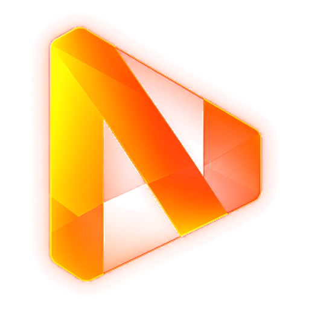

<p align="center"></p>

# Nexify

Lecteur de musique auto-hébergé inspiré de YouTube Music. Nexify réunit **YouTube Music**, **Spotify** et **Deezer** dans une application web installable sur iPhone, iPad, Android, Windows, macOS et Linux.

- **Fonctionne hors connexion** : après la première connexion, tout est gardé sur l’appareil (profil, playlists, titres « J’aime », bibliothèque, historique, interface). Le serveur ne sert qu’à synchroniser, à mettre à jour la bibliothèque et à diffuser les titres en ligne.
- **Téléchargements** : un titre, une playlist ou vos « J’aime » en un geste, pour une écoute sans connexion.
- **Fondu enchaîné** de 0 à 12 s, avec **préchargement du titre suivant** pour un enchaînement sans blanc.
- **Égaliseur 10 bandes** avec préampli et 14 préréglages, **égalisation du volume**.
- **Radio** : titres similaires à partir de n’importe quel titre, et lecture automatique à la fin de la file.
- **Personnalisation** : thème sombre, clair ou système, couleurs dynamiques tirées de la pochette, page de démarrage, affichage de la source des titres.
- Recherche simultanée sur les trois services, playlists Nexify mélangeant les sources, copie d’une playlist existante, file d’attente, aléatoire, répétition, écran verrouillé et touches multimédia.
- Plusieurs comptes par serveur ; données synchronisées entre tous vos appareils.
- Aucune dépendance npm : Node.js 22 et yt-dlp suffisent.

## Fonctionnement hors connexion

| Situation | Ce qui fonctionne |
|---|---|
| Première ouverture sur un appareil | Connexion au serveur requise (compte, récupération des données). |
| Serveur joignable | Tout : recherche, lecture en ligne, radio, synchronisation, téléchargements. |
| Serveur injoignable | L’appli s’ouvre normalement. Lecture des titres téléchargés, playlists et « J’aime » consultables et **modifiables**, recherche dans la bibliothèque, égaliseur et réglages. Les titres non téléchargés sont grisés. |
| Retour de la connexion | Synchronisation automatique ; les téléchargements en attente reprennent. |

Les modifications faites sur plusieurs appareils sont fusionnées élément par élément : la plus récente l’emporte, et une suppression se propage aux autres appareils.

## Installation du serveur (conteneur LXC ou VM Ubuntu / Debian)

En root :

```bash
curl -fsSL https://raw.githubusercontent.com/xenix13/nexify/main/deploy/install.sh | bash
```

Le script installe Node.js 22, yt-dlp (avec Deno, nécessaire à yt-dlp pour YouTube), Nexify dans `/opt/nexify`, un certificat auto-signé, le fichier `.env` et le service systemd `nexify`. Relancez la même commande pour mettre à jour : `.env` et les données sont conservés.

Ouvrez ensuite l’adresse affichée et créez le compte administrateur. Les autres comptes s’ajoutent dans **Paramètres → Comptes utilisateurs**.

### HTTPS reconnu : indispensable pour l’application installable

Les navigateurs n’activent le mode hors connexion (service worker) et l’installation de l’application que sur une connexion HTTPS **reconnue**. Avec le certificat auto-signé, Nexify fonctionne dans le navigateur mais ni hors connexion ni comme application.

Placez donc Nexify derrière un reverse proxy avec un vrai certificat (Nginx Proxy Manager, Caddy, Traefik…), par exemple `https://musique.mondomaine.fr` :

1. Dans `/opt/nexify/.env`, videz `TLS_CERT` et `TLS_KEY` et réglez `PUBLIC_URL=https://musique.mondomaine.fr`.
2. Faites pointer le proxy vers `http://IP-DU-CONTENEUR:8443`.
3. `systemctl restart nexify`.

Sans domaine public, un certificat d’une autorité locale (mkcert, autorité de votre réseau) installée sur chaque appareil fonctionne aussi.

### Installer l’application

- **iPhone / iPad** : dans Safari, bouton Partager → « Sur l’écran d’accueil ».
- **Android** : Chrome propose « Installer l’application » (ou menu ⋮ → Installer).
- **Windows / macOS / Linux** : Chrome ou Edge, icône d’installation dans la barre d’adresse, ou **Paramètres → À propos → Installer** dans Nexify.

Les mises à jour du serveur sont détectées automatiquement : l’application propose « Mettre à jour ».

## Applis Android et PC (sans serveur pour la musique)

En plus de l’appli web, Nexify existe en application pour **Android**, **Windows**, **Linux** et **macOS**. L’interface est la même, mais l’appareil récupère lui-même la musique sur YouTube Music : le serveur ne sert plus qu’à la connexion et à la synchronisation des playlists et titres « J’aime ».

| | Appli web (PWA) | Applis Android et PC |
|---|---|---|
| Lecture et téléchargement | via le serveur | **par l’appareil** (serveur en secours) |
| Recherche, accueil | via le serveur | serveur s’il répond, sinon **par l’appareil** |
| Serveur éteint ou injoignable | titres téléchargés uniquement | **tout fonctionne** (seule la synchronisation attend) |
| Certificat HTTPS reconnu | obligatoire | inutile : `http://IP:8443` suffit sur le réseau local |

- **PC (Electron)** : l’appli embarque le moteur Nexify et télécharge au premier lancement **yt-dlp** et **Deno** (tenus à jour automatiquement). Recherche, accueil, radio et lecture se font sur l’ordinateur.
- **Android (Capacitor)** : un module natif basé sur **NewPipeExtractor** (le moteur de l’appli NewPipe) fournit la recherche et le flux audio. Une notification « Lecture en cours » permet de continuer écran éteint. Les titres Spotify et Deezer sont mis en correspondance par le serveur, puis lus depuis le téléphone.
- **iPhone / iPad** : pas d’appli (il faudrait un compte développeur Apple) ; utilisez l’appli web.

### Télécharger les applis

Les fichiers sont construits par GitHub Actions et publiés dans les [Releases](https://github.com/xenix13/Nexify/releases) à chaque étiquette `v*` :

- **Android** : `Nexify-android.apk` (autorisez l’installation depuis votre navigateur ou gestionnaire de fichiers).
- **Windows** : `Nexify-…-win-x64.exe`. Windows SmartScreen peut avertir (appli non signée) : « Informations complémentaires » → « Exécuter quand même ».
- **Linux** : `.AppImage` (rendre exécutable) ou `.deb`.
- **macOS** : `.dmg` (appli non signée : clic droit → Ouvrir la première fois).

Au premier lancement, indiquez l’adresse de votre serveur (par exemple `http://192.168.1.50:8443`), puis connectez-vous.

Pour construire sans publier : onglet **Actions → Applications → Run workflow** ; les fichiers sont dans les artefacts du lancement.

### Signature de l’APK Android (recommandé)

Sans clé de signature, chaque APK est signé avec une clé de débogage différente : Android refusera alors de mettre à jour l’appli par-dessus la précédente (il faudra la désinstaller, ce qui efface les téléchargements). Pour des mises à jour normales, créez une fois une clé et enregistrez-la dans les secrets du dépôt (**Settings → Secrets and variables → Actions**) :

```bash
keytool -genkeypair -v -keystore nexify.jks -alias nexify -keyalg RSA -keysize 2048 -validity 10000
base64 -w0 nexify.jks    # contenu du secret ANDROID_KEYSTORE_BASE64
```

Secrets : `ANDROID_KEYSTORE_BASE64`, `ANDROID_KEYSTORE_PASSWORD`, `ANDROID_KEY_ALIAS` (`nexify`), `ANDROID_KEY_PASSWORD`. Gardez `nexify.jks` en lieu sûr.

## Connecter les services

**YouTube Music** : la recherche, la lecture et la radio fonctionnent sans compte. Pour retrouver votre bibliothèque, collez l’en-tête Cookie de music.youtube.com dans **Paramètres → Services** (instructions dans l’appli). Il est chiffré sur le serveur (AES-256-GCM).

**Spotify** : créez une application sur <https://developer.spotify.com/dashboard> (Web API et Web Playback SDK), ajoutez l’URI de redirection `PUBLIC_URL/api/spotify/callback`, déclarez les comptes dans *User Management* (5 au maximum en mode développement), renseignez `SPOTIFY_CLIENT_ID` et `SPOTIFY_CLIENT_SECRET` dans `.env`, redémarrez, puis **Paramètres → Services → Connecter Spotify**.

**Deezer** : collez le lien de votre profil public dans **Paramètres → Services**.

### Comment les titres sont lus

Par défaut, tous les titres passent par le moteur audio de Nexify : un titre Spotify ou Deezer est lu dans sa version YouTube Music (correspondance par titre, artistes et durée). C’est ce qui permet l’égaliseur, le fondu, le téléchargement et l’écoute hors connexion. Vous pouvez choisir dans **Paramètres → Lecture** de lire les titres Spotify avec Spotify (Premium, dans le navigateur ou sur un appareil Spotify Connect) ; ces titres ne bénéficient alors pas de l’égaliseur, du fondu ni du téléchargement.

Sans correspondance fiable, Nexify lit l’extrait officiel de 30 s plutôt qu’un mauvais titre.

### Limites à connaître

- **YouTube Music** n’a pas d’API officielle : un changement du site peut casser temporairement la recherche ou la lecture. yt-dlp est mis à jour chaque jour.
- **Spotify** en mode développement : 5 utilisateurs, contenu des playlists lisible seulement pour vos propres playlists, 10 résultats par page.
- **Deezer** n’accepte plus de nouvelles applications : seul le contenu public de votre profil est lu.
- **iPhone / iPad** : si la lecture s’interrompt écran verrouillé, désactivez **Paramètres → Lecture → Traitement audio avancé** (l’égaliseur et le fondu sont alors indisponibles).
- L’espace de stockage des téléchargements dépend du navigateur ; **Paramètres → Téléchargements → Stockage protégé** évite leur effacement automatique.

## Configuration (`.env`)

| Variable | Rôle |
|---|---|
| `APP_SECRET` | Clé de chiffrement des jetons et cookies enregistrés (générée par l’installation) |
| `PUBLIC_URL` | Adresse ouverte dans le navigateur ; sert à l’URI de redirection Spotify |
| `PORT`, `HOST` | Écoute (8443 sur toutes les interfaces par défaut) |
| `TLS_CERT`, `TLS_KEY` | Certificat HTTPS. Vides = HTTP simple, derrière un reverse proxy |
| `DATA_DIR` | Dossier des données (comptes, données synchronisées) |
| `ALLOW_SIGNUP` | `first` (seul le premier compte s’inscrit), `yes` ou `no` |
| `SPOTIFY_CLIENT_ID`, `SPOTIFY_CLIENT_SECRET` | Identifiants de l’application Spotify |
| `MARKET`, `LANG_UI` | Pays du catalogue et langue des résultats (`FR`, `fr`) |
| `YTDLP_BIN`, `YTDLP_EXTRA_ARGS`, `YTDLP_COOKIES_FILE` | Réglages de yt-dlp |

Une installation Spotihome existante est reprise automatiquement (`data/spotihome.json` → `data/nexify.json`, playlists comprises). Les connexions aux services sont à refaire, la clé de chiffrement ayant changé.

## Développement

```bash
cp .env.example .env      # renseignez APP_SECRET, videz TLS_CERT et TLS_KEY
npm run dev               # http://127.0.0.1:8443 (localhost est considéré comme sécurisé : mode hors connexion actif)
npm test                  # tests unitaires et de bout en bout (services simulés)
```

Ajoutez `?debug` à l’adresse pour accéder à `window.nexify` (lecteur, données, téléchargements) dans la console.

```
server/
  app.js              routes de l’API, sessions, synchronisation, service worker versionné
  proxy.js            relais des pochettes et extraits (même origine : cache hors ligne et Web Audio)
  providers/          spotify.js, deezer.js, ytmusic.js (recherche, bibliothèque, radio), ytdlp.js
  match.js            correspondance d’un titre vers YouTube Music
  store.js            base JSON (data/nexify.json), écriture atomique
public/
  sw.js               service worker : coquille de l’appli et pochettes hors ligne
  js/db.js            IndexedDB (données, collections, fichiers téléchargés)
  js/data.js          données locales d’abord, synchronisation
  js/merge.js         fusion entre appareils (partagée avec le serveur)
  js/downloads.js     téléchargements
  js/audio.js         moteur audio : deux platines, égaliseur, compresseur, fondus
  js/player.js        file d’attente, préchargement, fondu enchaîné, radio, Spotify
  js/native.js        applis Android / PC : adresse du serveur, jeton, moteur local
  js/source.js        d'où lire un titre (appareil d'abord, serveur en secours)
  js/views/           accueil, recherche, bibliothèque, collections, paramètres, lecteur
deploy/               install.sh et services systemd
desktop/              appli PC (Electron) : moteur local, yt-dlp et Deno téléchargés au premier lancement
mobile/               appli Android (Capacitor) : module natif NewPipeExtractor (native/java), scripts de génération
.github/workflows/    construction des applis et publication des Releases
```
